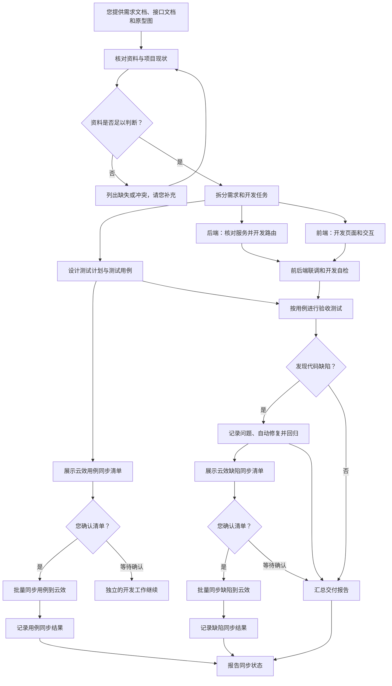

# Creek Delivery 插件使用与工作流程

这份文档帮助需求提出人了解：需要提供什么资料、插件如何推进、何时需要您确认，以及最后会收到什么。插件用于 `creek-qiankun` 前端和 `creek-web` 后端的需求交付。

> 当前状态：插件已安装，云效项目和测试用例库的只读访问已验证；云效写入和完整需求端到端运行尚未验证。下图描述插件规定的工作流程，实际执行受资料、权限、环境和工具可用性影响。

## 一、开始前准备什么

- **需求文档**：功能说明、业务规则、权限、状态变化和验收要求，包含有关附件。
- **接口文档**：接口路径、请求方法、参数、返回值、错误码和鉴权说明。
- **原型图**：页面、弹窗、跳转和交互说明；链接需要可访问。
- **其他资料**：字典、枚举、流程图、计算规则、示例数据等，以及可用的测试环境和测试账号（如涉及）。

在项目的新 Codex 聊天中上传资料，或给出文件路径、可访问链接，并输入：

```text
$creek-delivery
请根据附带的需求文档、接口文档和原型图完成需求开发与验收。
需求名称：填写名称
测试环境：填写地址或说明尚未提供
```

资料暂时不全也可以开始。插件会指出缺失内容，只暂停受影响的工作，其他可以独立推进的任务继续。

## 二、完整流程图



图中箭头表示依赖关系，不表示所有步骤必须排成一条队。测试用例设计、前端和后端开发可以在任务拆分后并行；联调等待前后端准备好，验收等待联调和用例准备好。云效同步等待确认，但不会因此阻止不依赖它的开发或报告。

## 三、每个阶段会发生什么

| 阶段 | 插件会做什么 | 您会看到什么 |
|---|---|---|
| 资料核对 | 阅读本次提供或引用的资料，检查相关页面、组件、服务和路由 | 资料清单、缺失项和需要澄清的问题 |
| 任务拆分 | 对照需求、原型和接口，确定前后端改动及依赖 | 工作范围与任务安排 |
| 用例设计 | 覆盖主要操作、失败、边界、权限和状态变化 | 测试计划、用例及需求覆盖情况 |
| 用例同步 | 准备云效项目、待新增或更新的用例及完整内容 | **先收到清单，确认后才写入云效** |
| 前后端开发 | 核对后端服务并处理路由；按项目规范完成页面和交互 | 代码改动与自检结果 |
| 联调和验收 | 检查构建、接口和关键交互，按用例记录实际结果 | 通过、失败、阻塞和未执行项及证据 |
| 修复和回归 | 记录确认的代码缺陷，自动修复并重测原问题及受影响功能 | 修复结果、回归结果及遗留问题 |
| 缺陷同步与交付 | 准备缺陷清单并汇总最终结果 | **确认缺陷清单后才写入云效**；收到交付报告 |

插件会分配需求设计、测试设计、后端、前端、测试修复和云效同步等 Agent；由编排 Agent 跟踪进度和交接。同一文件的修改需要协调，不能互相覆盖。

## 四、什么时候需要您处理

1. **补充资料或回答问题**：需求不完整、原型和接口冲突，且问题影响实现或验收时。
2. **确认云效同步**：插件先展示目标项目和本轮完整清单；您确认后才批量写入。清单内容或目标项目改变后，需要重新确认。
3. **解决环境或权限阻塞**：例如无法访问原型、缺少测试账号、云效权限不足或 Agent 工具不可用。

等待期间，无依赖的任务可以继续。云效同步成功、失败和待核对的项目会分别记录；若写入超时，插件先查询云效，无法确定结果时停止该项，避免重复创建。

## 五、最终会收到什么

交付报告应说明：需求覆盖情况、前后端改动、运行的检查、测试通过和失败情况、阻塞或未执行项、缺陷修复与回归、云效同步结果及遗留问题。**未执行或受阻的项目不会算作通过**；云效尚未确认或未同步也会单独说明。

## 六、中断后如何继续

在后续聊天中调用 `$creek-delivery`，说明需求名称并提供原批次目录，例如：

```text
$creek-delivery
请继续「设备管理」需求的原批次，批次目录：<原批次目录>
```

插件应读取该批次保存的资料、规则版本、阶段状态和交接记录，从未完成或受影响的工作继续；已成功同步的云效项目会先核对记录，避免重复写入。

## 七、流程以后如何调整

流程阶段和依赖位于 [workflow.json](../workflows/workflow.json)，详细规则位于插件的 `skills/creek-delivery/references/`。新批次使用更新后的配置；已有批次按保存的版本恢复。如需迁移已有批次，先查看差异和影响，并经您确认。

项目中的插件源码和 Codex 已安装的缓存是不同位置。修改源码后，需重新检查并验证安装版本是否已更新，不能假定当前聊天立即使用了新规则。
